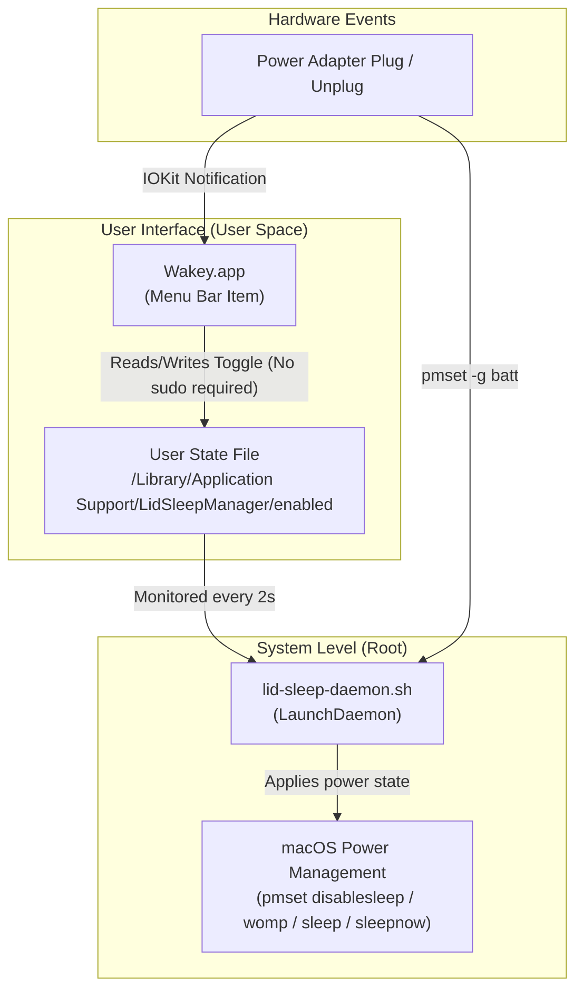

<p align="center">
  
</p>

<h1 align="center">Wakey ⚡️</h1>

<p align="center">
  A lightweight macOS menu bar app and LaunchDaemon that keeps your MacBook awake with the lid closed <strong>only while connected to AC power</strong>.
</p>

---

When plugged into power, Wakey disables clamshell sleep so SSH sessions, local servers, and background jobs keep running with the lid shut. The moment you unplug the charger—or toggle the feature off—normal sleep behavior is restored and a closed lid puts your Mac to sleep immediately, preventing battery drain and overheating inside a bag.

---

## ⚡️ Key Features

- **Peeking-Eyes Menu Bar Status**:
  - Custom template vector icon matching the app logo that adapts to current power and daemon state:
  - 👀 **Active (Awake on AC)**: Lid slightly open with peeking eyes — plugged into AC power and sleep is disabled on lid close.
  - 😴 **Standby (On Battery)**: Lid slightly open with closed eyes — running on battery; normal sleep is active and closing the lid sleeps immediately.
  - 💤 **Disabled**: Lid shut flat — manually toggled off; normal sleep behavior is active at all times.
  - ⚠️ **Helper Service Stopped**: Closed lid with warning dot — background helper daemon is not installed or not running.
- **Zero-Latency Power Sensing**:
  - Updates the menu bar immediately when the power adapter is connected or disconnected using native macOS `IOKit` run loop notifications (`IOPSNotificationCreateRunLoopSource`), backed by a 3-second fallback refresh.
- **Smart Sleep & Network Wake Management**:
  - When active on AC, sets `disablesleep 1`, enables Wake for network access (`womp 1`), and prevents idle AC sleep (`sleep 0`).
  - When inactive (battery or disabled), restores `disablesleep 0`, disables `womp` on AC (`womp 0`), and enforces `pmset sleepnow` if the lid is closed.
- **Self-Contained Helper Installer**:
  - The daemon script and `launchd` plist are bundled inside `Wakey.app`. On first launch, a native macOS administrator prompt installs the helper service with one click—no terminal required.
- **Drag-and-Drop DMG & Uninstall Protection**:
  - Distributed as `Wakey.dmg` with an `Applications` shortcut, and asks for explicit confirmation before uninstalling the helper service.

---

## 📋 Requirements

- **macOS** MacBook (Apple Silicon or Intel)
- **Administrator privileges** (one-time authorization to install or uninstall the root `LaunchDaemon` required by `pmset`)
- **To build from source**: Xcode Command Line Tools (`xcode-select --install`) providing `swiftc`, `make`, and `hdiutil`

> [!NOTE]
> `Wakey.app` is currently distributed without an Apple Developer notarized signature. When downloading from GitHub Releases, macOS Gatekeeper may ask you to confirm on first launch (see **Logs & Troubleshooting** below).

---

## 🏗 Architecture



---

## 🚀 Quick Start (Installation)

### Option 1: Download from GitHub Releases (Recommended)

1. Download the latest `Wakey.dmg` from [GitHub Releases](https://github.com/Nantaphat-Yoktaworn/wakey/releases).
2. Open `Wakey.dmg` and drag **`Wakey.app`** into **`Applications`**.
3. Open **`Wakey`** from `/Applications` (or Spotlight).
   - If macOS warns that the app is from an unidentified developer, **right-click `Wakey.app` → Open**, or go to **System Settings → Privacy & Security → Open Anyway**.
4. Click **Install** when prompted on first launch to authorize and start the background helper service.

### Option 2: Build DMG from Source

```bash
git clone https://github.com/Nantaphat-Yoktaworn/wakey.git
cd wakey
make dmg
open build/Wakey.dmg
```

Drag **`Wakey`** into **`Applications`**, launch it, and click **Install** when prompted.

### Option 3: CLI / Terminal Install

Build and install both `Wakey.app` and the `LaunchDaemon` directly via Terminal:

```bash
git clone https://github.com/Nantaphat-Yoktaworn/wakey.git
cd wakey

# Build and install (requires sudo)
make install

# Launch the menu bar app
open /Applications/Wakey.app
```

---

## 💻 How to Use It

1. **Keep Awake / SSH with the Lid Closed:**
   - Plug your MacBook into AC power.
   - Verify the menu bar icon shows **Active** (peeking eyes).
   - Close the lid. Your Mac stays awake and reachable over the network.
2. **Pack Up / Run on Battery:**
   - Unplug the power adapter.
   - The icon switches to **Standby** (closed eyes), and closing the lid puts your Mac to sleep immediately.
3. **Temporarily Disable:**
   - Click the menu bar icon and uncheck **"Keep Awake on AC Power"**.
   - Your Mac sleeps normally even while plugged in.

---

## ⚙️ Prerequisites for SSH Access

To connect via SSH when your Mac is awake on AC power:

1. Open **System Settings → General → Sharing**.
2. Enable **Remote Login** and allow access for your user account.
3. Find your Mac's local IP address (`ipconfig getifaddr en0`) or mDNS hostname:
   ```bash
   ssh user@your-macbook.local
   ```

---

## 🛠 Project Structure

```text
wakey/
├── .github/
│   └── workflows/
│       └── ci.yml                          # GitHub Actions CI (plist lint, bash check, DMG build)
├── App/
│   ├── main.swift                          # Native macOS Swift menu bar app
│   ├── Info.plist                          # App metadata & bundle configuration
│   └── Resources/
│       ├── AppIcon.icns                    # Bundled macOS app icon
│       └── icon.png                        # Source 1024x1024 app icon artwork
├── Daemon/
│   ├── lid-sleep-daemon.sh                 # Root LaunchDaemon script managing pmset
│   └── com.lidsleepmanager.daemon.plist    # launchd service definition
├── Scripts/
│   ├── build.sh                            # Compiles Swift binary & assembles Wakey.app
│   ├── create_dmg.sh                       # Packages drag-and-drop build/Wakey.dmg
│   ├── install.sh                          # Direct CLI installer (requires sudo)
│   └── uninstall.sh                        # Clean removal script (requires sudo)
├── Makefile                                # Build, DMG, install, and uninstall targets
├── LICENSE                                 # MIT License
└── README.md
```

---

## 🔧 Developer Commands

| Command | Description |
| :--- | :--- |
| `make build` | Compiles `Wakey.app` into `build/Wakey.app` |
| `make dmg` | Compiles and packages `build/Wakey.dmg` |
| `make install` | Installs `Wakey.app` and the LaunchDaemon via CLI (`sudo`) |
| `make uninstall` | Removes app, daemon, state, logs, and restores default sleep (`sudo`) |
| `make run` | Builds and opens `build/Wakey.app` |
| `make clean` | Removes the `build/` directory |

---

## 🗑 Uninstall

### Via Menu Bar App

1. Click the **Wakey** menu bar icon and select **"Uninstall Helper Service..."**.
2. Confirm the prompt and enter your administrator password. This unloads and removes the `LaunchDaemon`, deletes `/usr/local/bin/lid-sleep-daemon.sh` and `/Library/Application Support/LidSleepManager`, and restores default `pmset` settings.
3. Select **Quit Wakey** and move `/Applications/Wakey.app` to Trash.

### Via Terminal (Full Removal)

From the cloned repository directory:

```bash
make uninstall
# or directly:
sudo ./Scripts/uninstall.sh
```

This stops all Wakey processes, unloads `com.lidsleepmanager.daemon`, removes `/Applications/Wakey.app`, `/usr/local/bin/lid-sleep-daemon.sh`, `/Library/Application Support/LidSleepManager`, and daemon logs, and restores default macOS sleep settings (`pmset -a disablesleep 0`, `pmset -c womp 1`, `pmset -c sleep 0`).

---

## 📜 Logs & Troubleshooting

- **View daemon logs:**
  ```bash
  tail -f /var/log/lid-sleep-manager.log /var/log/lid-sleep-manager.err
  ```
- **Verify LaunchDaemon status:**
  ```bash
  sudo launchctl list | grep com.lidsleepmanager.daemon
  ```
- **Check current power & sleep settings:**
  ```bash
  pmset -g | grep -iE "sleep|womp"
  pmset -g batt
  ```
  *(When active on AC: `SleepDisabled 1`, `womp 1`, and `sleep 0` are set. When inactive: `SleepDisabled 0`, `womp 0`, and `sleep 1`.)*
- **Check physical lid (clamshell) state:**
  ```bash
  ioreg -r -k AppleClamshellState -d 1 | grep AppleClamshellState
  ```
- **Gatekeeper blocks first launch (GitHub Releases download):**
  Right-click `/Applications/Wakey.app` and choose **Open**, or remove the quarantine attribute:
  ```bash
  xattr -dr com.apple.quarantine /Applications/Wakey.app
  ```
- **Manually restore default macOS sleep settings** (if the daemon was removed unexpectedly):
  ```bash
  sudo pmset -a disablesleep 0 && sudo pmset -c womp 1 && sudo pmset -c sleep 0
  ```

---

## 📄 License

This project is licensed under the [MIT License](LICENSE).
