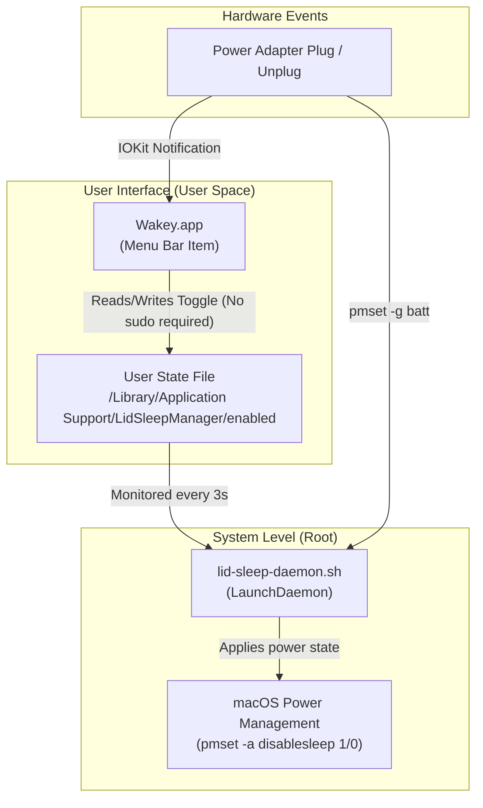

# Wakey ⚡️

A sleek, ultra-lightweight macOS Menu Bar application and background daemon that keeps your MacBook awake when the lid is closed **only when connected to a power adapter (AC power)**.

When on battery power, your Mac sleeps immediately and safely upon closing the lid, preventing battery drain and overheating inside a bag or backpack.

---

## ⚡️ Key Features

- **Minimalist Menu Bar Status**:
  - Custom vector icon matching the app logo (side-view MacBook with lid half-closed).
  - ⚡️ **Active (Awake on AC)**: MacBook is plugged in; sleep is disabled when the lid is closed. SSH sessions remain active.
  - 🔋 **Standby (On Battery)**: MacBook is on battery; normal sleep behavior is active to prevent overheating.
  - 💤 **Disabled**: Feature is manually toggled off; normal sleep behavior is active at all times.
  - ⚠️ **Warning**: Helper service is stopped or needs installation.
- **Zero-Latency Power Sensing**:
  - Automatically updates the menu bar and power profile the exact millisecond the power cable is connected or disconnected using native macOS `IOKit` run loop notifications (`IOPSNotificationCreateRunLoopSource`).
- **Drag-and-Drop Installation**:
  - Packaged as a `.dmg` with an `/Applications` shortcut.
- **Self-Contained Helper Service**:
  - The background daemon is embedded directly within the app bundle. On first launch, a native macOS authorization prompt allows you to install it with one click—no terminal required.
- **Uninstall Protection**:
  - Explicit confirmation alert before removing the background helper service to prevent accidental uninstalls.
- **Zero Resource Impact**:
  - Background daemon runs via `launchd` with virtually 0% CPU and negligible memory footprint.

---

## 🏗 Architecture



---

## 🚀 Quick Start (Installation)

### Option 1: Drag-and-Drop via DMG (Recommended)

1. Build or open the DMG:
   ```bash
   make dmg
   open build/Wakey.dmg
   ```
2. Drag **`Wakey`** into the **`Applications`** folder.
3. Open **`Wakey`** from Applications (or via Spotlight).
4. Click **Install** when prompted on first launch to enable the background service.

### Option 2: CLI / Terminal Install

If you prefer building and installing directly via Terminal:

```bash
# Build and install (requires sudo)
make install

# Launch the app
open /Applications/Wakey.app
```

---

## 💻 How to Use It

1. **SSH with the Lid Closed:**
   - Plug your MacBook into its charger.
   - The status icon lights up (Active).
   - Close the laptop lid. Your Mac stays awake, Wi-Fi stays connected, and you can SSH into it anytime.

2. **On the Move / Packing into a Bag:**
   - Unplug the power adapter.
   - The status icon switches to Standby.
   - Close the lid. Your Mac goes to sleep immediately and safely.

3. **Temporarily Disable:**
   - Click the menu bar icon and uncheck **"Keep Awake on AC Power"**.
   - Your Mac will now sleep normally even when plugged in.

4. **Uninstall Helper Service:**
   - Click the menu bar icon and select **"Uninstall Helper Service..."**.
   - Confirm in the dialog prompt. The service is removed and default macOS sleep settings are restored.

---

## ⚙️ Prerequisites for SSH Access

To connect via SSH when your Mac is awake:
1. Open **System Settings** → **General** → **Sharing**.
2. Enable **Remote Login**.
3. Allow access for your user account.
4. Find your Mac's local IP address (`ipconfig getifaddr en0`) or use its hostname (e.g., `ssh user@your-macbook.local`).

---

## 🛠 Project Structure

```
lid-sleep-manager/
├── App/
│   ├── main.swift             # Native macOS Swift Menu Bar app
│   ├── Info.plist             # App metadata & bundle configuration
│   └── Resources/             # AppIcon.icns & assets
├── Daemon/
│   ├── lid-sleep-daemon.sh    # Background daemon script managing pmset
│   └── com.lidsleepmanager.daemon.plist  # launchd service definition
├── Scripts/
│   ├── build.sh               # Compiles Swift app & bundles resources
│   ├── create_dmg.sh          # Generates drag-and-drop Wakey.dmg
│   ├── install.sh             # Direct CLI installer
│   └── uninstall.sh           # Clean removal script
├── Makefile                   # Quick build & install shortcuts
├── LICENSE                    # MIT License
└── README.md
```

---

## 🔧 Developer Commands

| Command | Description |
| :--- | :--- |
| `make build` | Compiles `Wakey.app` into `build/Wakey.app` |
| `make dmg` | Compiles and packages `build/Wakey.dmg` |
| `make install` | Installs app and daemon directly via CLI (`sudo`) |
| `make uninstall` | Removes app, daemon, and restores default sleep (`sudo`) |
| `make run` | Builds and opens `Wakey.app` |
| `make clean` | Removes the `build/` directory |

---

## 📜 Logs & Troubleshooting

- **Daemon log:** `/var/log/lid-sleep-manager.log`
- **Daemon error log:** `/var/log/lid-sleep-manager.err`
- **Check current sleep state:**
  ```bash
  pmset -g | grep -i sleep
  ```
  *(When active, `sleep 0` and `SleepDisabled 1` will be set)*.
- **Check power status:**
  ```bash
  pmset -g batt
  ```

---

## 📄 License

This project is licensed under the [MIT License](LICENSE).
